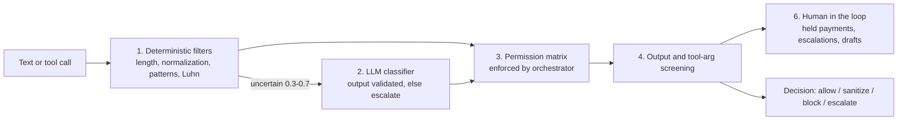
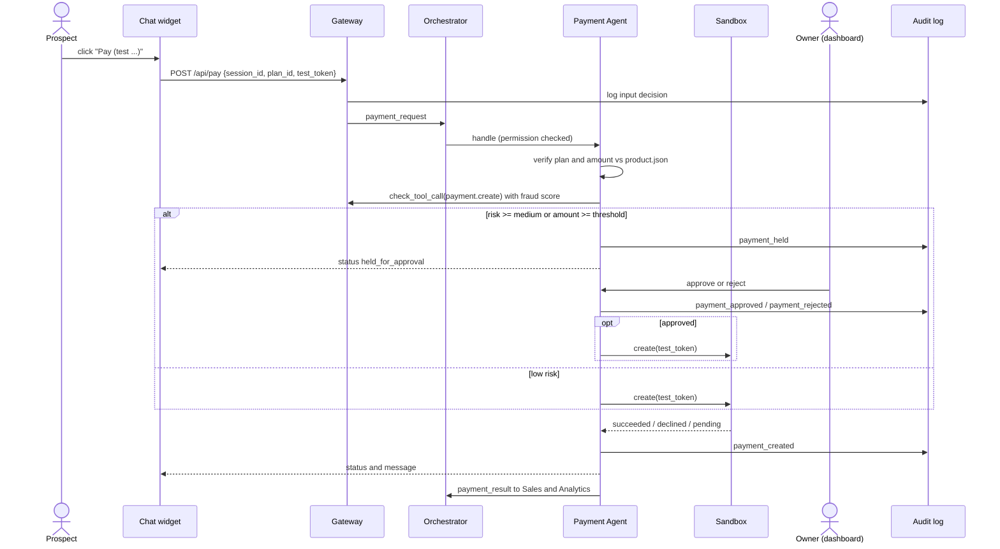

# Architecture

SoukSaaS is a small team of cooperating agents behind a layered security gateway. All state lives in SQLite, and every decision is written to a hash-chained audit log. Everything financial is simulated.

## 1. System overview

```mermaid
flowchart TD
    Owner([Owner]) -->|dashboard intake + optional PDF| API[Owner API]
    API --> Parser[Text-only PDF parser]
    API --> PJ[(Product drafts and published snapshots)]
    PJ --> Page[Generated page + chat + feedback<br/>Jinja2 + vanilla JS]
    PJ --> QAGen[Q&A generation: draft]
    QAGen -->|owner validates| QA[(Approved Q&A base)]

    Prospect([Prospect]) --> Page
    Page -->|/api/chat, /api/pay, /api/rating| GWI{{Security Gateway<br/>check_input}}
    Page -->|/api/feedback/{slug}| FB[Feedback handler and deterministic scoring]
    GWI --> ORCH[Orchestrator<br/>envelopes, permissions, timeout, retries]

    ORCH --> Sales[Sales Agent<br/>Q&A first, LLM fallback]
    ORCH --> Pay[Payment Agent<br/>sandbox, approval gate]
    ORCH --> Ins[Insights and Strategy Agent<br/>analyze / opportunities]

    Sales --> QA
    Sales -->|payment_request| Pay
    Pay --> SB[Payments sandbox<br/>simulated]

    Sales --> GWO{{Gateway<br/>check_output / check_tool_call}}
    Pay --> GWO
    Ins --> GWO

    GWO --> DB[(SQLite shared state)]
    GWO --> AUD[(Hash-chained audit log)]
    DB --> AN[Analytics service<br/>deterministic KPIs, no LLM]
    FB --> DB
    DB --> IS[Evidence-backed product suggestions]
    IS --> OUT[Owner inbox + Markdown outbox]
    AUD --> API
    AN --> API[FastAPI owner API<br/>X-Owner-Token]
    API --> Dash[Streamlit dashboard<br/>Products, Inbox, Suggestions, KPIs, approvals, audit, evals]
    Dash --> Owner
```

## 2. Gateway layers



## 3. Payment flow



## 4. Cahier agents to modules

| Cahier agent | Module |
|---|---|
| 1. Voice Sales Agent | `app/agents/sales.py` (text chat, voice simulated, optional browser speech) |
| 2. Customer Intelligence + 5. Business Strategy | `app/agents/insights.py` (modes analyze, opportunities) |
| 3. Payment Agent | `app/agents/payment.py` + `app/services/payments_sandbox.py` |
| 4. Financial Data Analyst | `app/services/analytics.py` (plain code, LLM only for optional narrative) |
| 6. Security and Fraud Detection | `app/gateway/` (filters, classifier, fraud) + `app/permissions.py` + `app/audit.py` |
